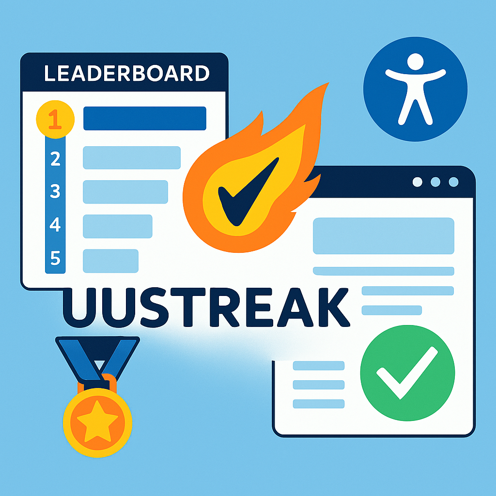

# Spillifisering av statusmålinger

Tilsynet for universell utforming av ikt (uutilsynet) utførte ["statusmålinger" av norske nettsider i 2014, 2015, 2017 og 2018](https://www.uutilsynet.no/statusmalingar/digitale-barrierar-avdekka-i-statusmalingar/1179) men har ikke utført noen flere statusmålinger etter dette.

Dette prosjektet har som mål å utføre en statusmåling av norske nettsider med automatisk testing og "[spillifisere](https://no.wikipedia.org/wiki/Spillifisering)" det å ha en nettside uten WCAG-brudd ved å lage en "highscore"-liste som oppdateres jevnlig med "streak"-score på antall dager uten WCAG-brudd.

Prosjektet bruker i utgangspunktet listen fra 2018 med 278 nettsider i privat og offentleg sektor, men vil utvides med flere store norske nettsider fremover.

Løsningen kjører Playwright med AXE på GitHub Actions.

Lansert på ODIN konferansen i 2025 i forbindelse med presentasjonen ["Levende Tilgjengelighetserklæring"](https://event.dataforeningen.no/odin2025/program/) med [Tobias Müller Andersen](https://www.linkedin.com/in/turbolego/) og [Lilly Arstad Helmersen](https://www.linkedin.com/in/lillyahelmersen/)

## WCAG-skill for KI-agenter

[wcag-skill på ClawHub](https://clawhub.ai/turbolego/skills/wcag-skill) er en
relatert ferdighet for KI-agenter som bygger, tester og retter nettinnhold etter
WCAG 2.2. Den kombinerer verktøy for automatiserte tilgjengelighetstester med en
evidensmatrise og manuelle kontroller. Automatiserte testresultater alene er ikke
bevis på at alle WCAG-krav er oppfylt.

* [Finn wcag-skill på ClawHub](https://clawhub.ai/turbolego/skills/wcag-skill)
* [Les dokumentasjon og kildekode på GitHub](https://github.com/turbolego/wcag-skill)

## Maskinlesbar informasjon på nettstedet

Sidene i [sitemap.xml](sitemap.xml) har egne metabeskrivelser og schema.org
`WebPage`-metadata med `dateModified`. Datoen gjelder sidens innhold og metadata,
ikke tidspunktet for den nyeste tilgjengelighetstesten. Oppdater datoen når
sideteksten endres; rapportdatoene vises separat i dashboardet.

Forsiden har en «Grafer og verktøy»-nedtrekksmeny med lenker til grafer,
axe-core-testeren og GitHub Discussions. Menyen bruker HTML `details`/`summary`
og kan åpnes med tastatur uten JavaScript.
Statiske seksjoner beskriver arbeidet, bidrag, kontakt, prosjektets
bakgrunn og nyhetsomtale, med vanlige lenker som fungerer uten JavaScript.

## Feil fra eksterne leverandører og embedded kode

En nettside består ofte av mer enn koden virksomheten utvikler og forvalter
selv. Mange nettsider inkluderer embedded kode fra eksterne leverandører,
blant annet løsninger for cookie-samtykke, analyse, chat, skjemaer, markedsføring
og betaling.

Slike komponenter kan bli oppdatert av leverandøren uten at nettsidens eget
utviklingsteam gjør endringer. Det betyr at nye WCAG-brudd kan oppstå i
produksjon selv om virksomhetens egen kode ikke er endret og alle interne tester
fortsatt passerer.

Feilene kan også være vanskelige å oppdage under lokal utvikling. En utvikler
som tidligere har lagret et valg i et cookie-banner, får for eksempel ikke
nødvendigvis se komponenten igjen under vanlig testing. Dermed kan feil i
tredjepartskode bli liggende uoppdaget dersom man bare tester egen kode eller
kjører tester før produksjonssetting.

UUstreak.no tester den faktiske nettsiden slik den fremstår i produksjon.
Løsningen kan derfor oppdage tilgjengelighetsfeil som kommer fra både
virksomhetens egen kode og embedded kode fra eksterne leverandører.

Når det finnes tilstrekkelig teknisk evidens, kategoriserer UUstreak.no om et
funn ser ut til å komme fra:

* nettsidens eget innhold
* embedded kode fra en ekstern leverandør
* en kombinasjon av nettsidens innhold og embedded kode

Deteksjonen ser etter elementer som `script`, `iframe` og `embed`, i tillegg til
kjennetegn fra vanlige leverandører av samtykkeløsninger, blant annet OneTrust,
TrustArc, Cookiebot, Didomi, ConsentManager, Quantcast og Usercentrics.

Kategoriseringen er basert på tekniske kjennetegn i den testede nettsiden. Den
skal gjøre resultatene mer informative, men er ikke en fasit på hvem som har
ansvar for å rette feilen.

Dette understreker hvorfor tilgjengelighet ikke bare bør testes når kode
utvikles eller publiseres. Nettsiden bør også overvåkes kontinuerlig i
produksjon, slik at feil fra både egen kode og eksterne avhengigheter blir
oppdaget raskt.

Alle testene genereres fra scratch hver gang med [generate_specs.py](https://github.com/turbolego/uustreak/blob/main/generate_specs.py) fra listen med nettsider i [projects.json](https://github.com/turbolego/uustreak/blob/main/projects.json) slik at man alltid tester likt. Testene kjøres med incognito modus med chromium med firefox og webkit som fallbacks.

## Prestasjonssporing

[Prestasjonsporingen](js/track-achievements.js) oppdaterer prestasjonene i
[projects.json](projects.json). «Nobody's Perfect» tildeles når en streak på
minst 365 dager avsluttes med en rapport som inneholder brudd. For eksempel:

```json
{
  "type": "nobodys_perfect",
  "fromDate": "2025-09-18",
  "toDate": "2026-09-30",
  "lostDate": "2026-10-01",
  "lostReason": "Page content: 2 violations found: Elements must meet minimum color contrast ratio thresholds (2)",
  "unlockedDate": "2026-10-02",
  "streakDays": 378
}
```

`lostReason` beskriver hvorfor streaken ble brutt på `lostDate`. Beskrivelsen
inkluderer om bruddene ser ut til å komme fra nettsidens eget innhold, embedded
kode fra en ekstern leverandør, eller begge deler. Den viser også totalt antall
brudd og opptil tre regelbeskrivelser med antall forekomster.

Kategoriseringen er viktig fordi tilgjengelighetsfeil ikke nødvendigvis kommer
fra kode som nettstedets eget utviklingsteam kontrollerer. En ekstern leverandør
kan oppdatere en innebygd komponent og introdusere nye WCAG-brudd uten at det
gjøres endringer i nettstedets egen kode.

Embedded kode identifiseres ved hjelp av kjennetegn fra vanlige leverandører av
samtykkeløsninger, blant annet OneTrust, TrustArc, Cookiebot, Didomi,
ConsentManager, Quantcast og Usercentrics. Trackeren ser også etter evidens i
elementer som `script`, `iframe` og `embed`.

Resultatet vises i achievement-dialogen sammen med datoen streaken ble brutt.
Kategoriseringen er basert på tekniske kjennetegn og skal forstås som en
indikasjon på hvor feilen kommer fra, ikke som en endelig vurdering av ansvar.
Eksisterende prestasjoner som mangler en årsak, blir oppdatert neste gang
trackeren kjører dersom den tilhørende rapporten er tilgjengelig.

Kjør `node js/track-achievements.js` når den historiske streak-indeksen eller
rapportlisten er tilgjengelig. Rapporter leses lokalt når de finnes. Sett
`SITE_BASE_URL` til URL-en til det publiserte nettstedet for å hente manglende
rapporter for datoen streaken ble brutt, slik den planlagte arbeidsflyten gjør.
Hvis en rapport ikke kan leses, logger trackeren en advarsel og lar
`lostReason` være `null` (eller beholder eksisterende verdi for en allerede
registrert prestasjon), slik at et senere kjør kan prøve på nytt uten å finne
på en årsak.

Kjør de målrettede regresjonstestene med
`node --test js/track-achievements.test.js`.

# Nettsider endret eller fjernet fra listen

Listen med de 278 nettsidene fra statusmålingen til uutilsynet i 2018 er brukt som utgangspunkt, men jeg har endret noen av disse:

* "Skedsmo kommune" ble slått sammen med "Lillestrøm kommune" i 2020, test utføres på "Lillestrøm kommune" sin nettside.
* "Norges Statsbaner AS" endret til "Vygruppen AS" pga. navneenndringen i 2019
* "Nemi Forsikring AS" slått sammen med "Storebrand ASA" pga. sammenslåingen i 2020
* "Carlsen Fritzøe Handel AS" slått sammen med "Byggmakker" pga. sammenslåingen i 2020
* "Stamina Trening AS" slått sammen med "Family Sports Club AS" pga. sammenslåingen i 2019
* "Direktoratet for forvaltning og ikt" slått sammen med "Digitaliseringsdirektoratet" pga. sammenslåingen i 2020
* "Get AS" slått sammen med "Telia Norge AS" pga. sammenslåingen i 2020
* "Hafslund Nett AS" slått sammen med "Elvia AS" pga. sammenslåingen i 2020
* "Hamar Media AS" fikk nytt navn "KildeGruppen AS" i 2023
* "Helgeland Sparebank" slått sammen med "Sparebank 1 DA" pga. sammenslåingen i 2021
* "Sparebanken Sogn og Fjordane" slått sammen med "Sparebank 1 DA" pga. sammenslåingen i 2023
* "Sparebanken Sør" slått sammen med "Sparebank 1 DA" pga. sammenslåingen i 2024
* "Sørlandsruta AS" endret til "Connect Bus AS" pga. sammenslåingen i 2022
* "Vest-Agder fylkeskommune" slått sammen med "Agder fylkeskommune" pga. sammenslåingen i 2020
* "Ski kommune" endret til "Nordre Follo kommune" pga. sammenslåingen i 2020
* privat-omsorg.no er lagt ned og erstattet med bpa-nord.no
* bergenclinics.no slått sammen med helse-bergen.no - [Bergensklinikkene er historie – Helse Bergen overtar](https://www.rusfeltet.no/arkiv/bergensklinikkene-er-historie-helse-bergen-overtar)
* Nettsidene for Alta Ungdomsskole ble flyttet fra alta.ungdomsskole.no til underside av alta.kommune.no

# Oppdagelse for KI-agenter

[Skills-indeksen](.well-known/agent-skills/index.json) følger Agent Skills
Discovery-utkastet v0.2.0 og peker til et commit-låst arkiv av wcag-skill, inkludert
referanser og skript. `digest` er SHA-256 av de nedlastede arkivbytene. Ved
oppdatering må både commit-URL og digest oppdateres sammen etter at arkivet er
lastet ned og kontrollert. En oppføring er ikke tillatelse til å kjøre skriptene.
Indeksen kopieres til Pages sammen med resten av `.well-known/`.

[robots.txt](robots.txt) erklærer `ai-train=yes`, `search=yes` og `ai-input=yes`
med Content Signals, i tråd med prosjektets eksisterende åpne crawler-policy.
Dette er preferanser, ikke tilgangskontroll; ikke alle roboter støtter direktivet.
Forsidens HTML har også `describedby`-lenker til LLM-oversikten, KI-katalogen og
skills-indeksen.

GitHub Pages støtter ikke egendefinerte HTTP-responshoder eller innholdsforhandling
basert på `Accept`. HTML-lenkene erstatter derfor ikke RFC 8288 `Link`-responshoder,
og `llms.txt` er ikke Markdown-innholdsforhandling. Disse funksjonene krever en
separat proxy/CDN eller annen hosting. En slik proxy kan for eksempel legge til:

```http
Link: </llms.txt>; rel="describedby"; type="text/plain", </.well-known/ai-catalog.json>; rel="describedby"; type="application/json", </.well-known/agent-skills/index.json>; rel="describedby"; type="application/json"
```

UUStreak publiserer statiske JSON-rapporter, ikke en beskyttet API-, OAuth-, MCP-
eller A2A-tjeneste. Det publiseres derfor ikke fiktive API-kataloger, helsesjekker,
autentiseringsmetadata eller serverkort for å tilfredsstille generiske skannere.
DNS-AID krever reelle agentendepunkter og DNS-endringer hos domeneleverandøren.
WebMCP-verktøy er heller ikke registrert; vanlige lenker og HTML-kontroller er ikke
WebMCP-verktøy.

Kjør regresjonstestene med `node --test js/agent-discovery.test.js`.


